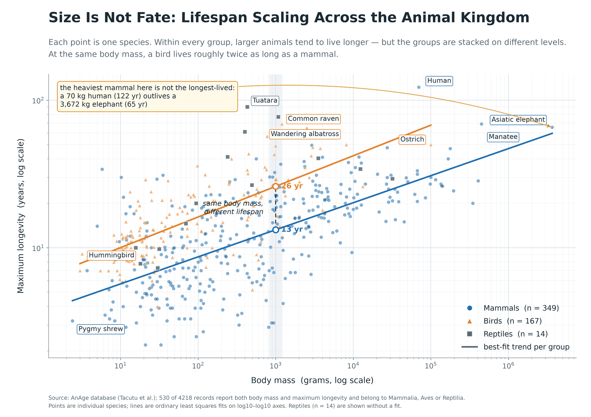

# WANG XUYANG — Data Science Portfolio

**MSc Precision Medicine (PMD)** · University of Macau

I work on **data science and data visualization**: turning a raw dataset into a figure that states a
finding, and into a script that reproduces it. This page collects the projects I have built during
**CISC7204 — Data Science and Data Visualization** at the University of Macau.

## Skills

**Analysis** Python · pandas · NumPy · statistical modelling (OLS, log–log scaling) · data cleaning
**Visualization** matplotlib · Seaborn · Bokeh · ggplot · colour-blind-safe palettes · annotation design
**Tooling** Jupyter · Git / GitHub · GitHub Pages · reproducible pipelines

## Project

### Does body size buy longevity? — scaling across the animal kingdom
**Status:** ongoing

**Research question:** across species, does a larger body predict a longer maximum lifespan — and
does the same rule hold for mammals, birds and reptiles?

**Data:** 530 species from the [AnAge database](https://genomics.senescence.info/species/) with both
body mass and maximum longevity recorded (mammals 349, birds 167, reptiles 14; 4,218 raw records).

**What the figure shows:** on log–log axes each class forms its own band. Within a class, a tenfold
increase in mass predicts only about a 1.5-fold gain in lifespan (slope 0.183 for mammals, 0.207 for
birds). Between classes the slopes are nearly parallel but the levels are not: at the **same 1 kg**
of body mass the fitted model gives **13 years for a mammal and 26 for a bird**. The labelled
exceptions — a 70 kg human outliving a 3,672 kg elephant, a 3 g hummingbird outliving a 2.4 g shrew —
show where size stops explaining the answer.

- **Repository:** https://github.com/3169715696-jpg/data-science-project
- **Reproduce:** `pip install -r requirements.txt && python anage_analysis.py` (dataset download
  instructions in the repo README)

## About this portfolio

Built with GitHub Pages. Every project page links to a public repository containing the code, the
data source and the instructions needed to regenerate the figures.
